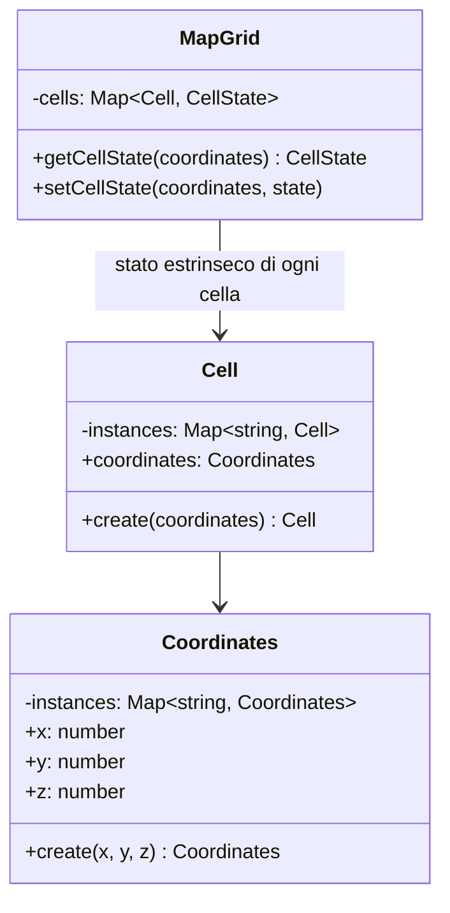
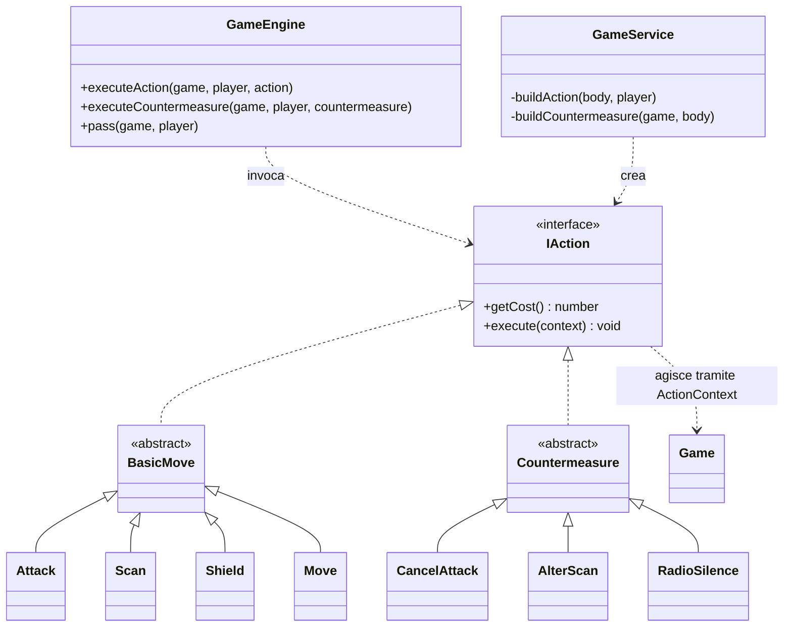
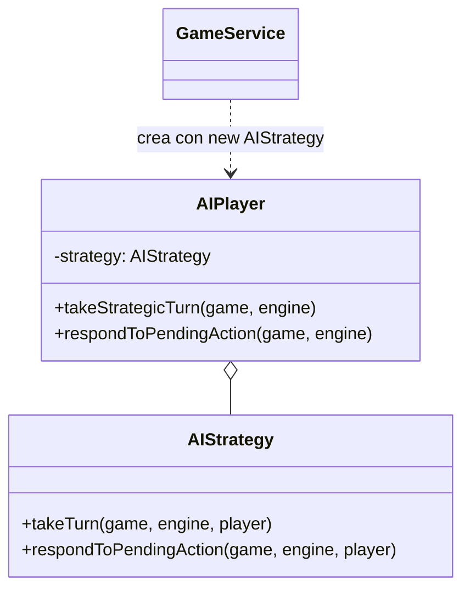

# Space Battleship 3D

Backend REST per una battaglia navale tridimensionale, sviluppato per l'esame di **Programmazione Avanzata**.

## Indice

1. [Obiettivo del progetto](#1-obiettivo-del-progetto)
2. [Strumenti di sviluppo](#2-strumenti-di-sviluppo)
3. [Struttura del progetto](#3-struttura-del-progetto)
4. [Regole del gioco](#4-regole-del-gioco)
5. [Diagrammi UML](#5-diagrammi-uml)
6. [Design pattern utilizzati](#6-design-pattern-utilizzati)
7. [Installazione](#7-installazione)
8. [Configurazione](#8-configurazione)
9. [Test](#9-test)
10. [Autore](#10-autore)

---

# 1. Obiettivo del progetto

Realizzare un backend REST per **Space Battleship 3D**, variante tridimensionale della battaglia navale.

Il sistema permette a utenti autenticati tramite JWT di creare e giocare partite:

- utente contro utente;
- utente contro IA.

Ogni partita comprende:

- griglia tridimensionale configurabile;
- flotte piazzate in modo casuale (il creatore può anche posizionare a mano alcune navi);
- gestione dei turni;
- Energy Credits;
- TOKEN associati agli utenti;
- azioni principali e contromisure;
- persistenza completa dello stato di gioco;
- storico delle mosse esportabile in CSV;
- autenticazione e autorizzazione con i ruoli `user` e `admin`.

Il livello HTTP, la logica applicativa, il dominio di gioco e la persistenza sono separati, così ogni parte si può testare da sola.

# 2. Strumenti di sviluppo

| Strumento | Uso |
|---|---|
| Node.js 24 | runtime |
| TypeScript | linguaggio principale |
| Express 5 | API REST |
| Sequelize 6 | ORM |
| MySQL 8 | database relazionale |
| Docker e Docker Compose | esecuzione di database e backend in container |
| Zod 4 | validazione degli input a runtime e derivazione dei tipi |
| jsonwebtoken | JWT firmati con RS256 (chiave privata per firmare, pubblica per verificare) |
| bcrypt | hash delle password |
| dotenv | variabili d'ambiente |
| http-status | codici HTTP |
| Jest e ts-jest | test |
| Supertest | test delle rotte HTTP |
| nodemon e ts-node | sviluppo con ricarica automatica |
| Postman | prova manuale delle rotte |

# 3. Struttura del progetto

```text
progettoPA_Piccinini_Quattrini/
├── src/
│   ├── cli/                  # CLI testuale per provare il dominio senza REST
│   ├── config/               # connessione Sequelize
│   ├── controllers/          # gestione di richiesta e risposta HTTP
│   ├── errors/               # AppError ed ErrorFactory
│   ├── middleware/           # auth, ruoli, validazione Zod, logger, error handler
│   ├── models/
│   │   ├── Action/           # IAction, BasicMove, Countermeasure
│   │   │   ├── BasicMove/    # Attack, Scan, Shield, Move, AttackResult
│   │   │   └── Countermeasure/ # CancelAttack, AlterScan, RadioSilence
│   │   ├── Engine/           # Game, GameEngine, GameState, EnergyConfig, HistoryCsv
│   │   ├── Players/          # IPlayer, HumanPlayer, AIPlayer, AIStrategy
│   │   ├── db/               # modelli Sequelize e relazioni
│   │   ├── fleet/            # Fleet, Ship, FleetConfig, FleetFactory
│   │   ├── grid/             # Grid, MapGrid, Cell, Coordinates, GridFactory
│   │   ├── user.ts           # utente di dominio (identità e saldo TOKEN)
│   │   ├── UserType.ts       # ruoli, tipi utente, modalità di gioco
│   │   └── MoveRecord.ts     # riga dello storico
│   ├── repository/           # accesso ai dati e mapping DB <-> dominio
│   ├── routes/               # route REST
│   ├── seeds/                # utenti iniziali
│   ├── services/             # logica applicativa
│   ├── Zod/                  # schemi di validazione
│   ├── TokenCost.ts          # costi in TOKEN
│   ├── jwtKey.ts             # lettura delle chiavi JWT
│   ├── app.ts                # configurazione di Express
│   └── server.ts             # avvio, connessione al DB, sync delle tabelle
├── tests/                    # test Jest
├── Sequence Diagrams/        # immagini dei diagrammi UML
├── jwtRS256.key.pub          # chiave pubblica per verificare i JWT
├── Dockerfile
├── docker-compose.yaml
├── jest.config.js
├── tsconfig.json
├── package.json
└── README.md
```

`dist/` viene generata da `npm run build` e non va modificata a mano.

## 3.1 Flusso di una richiesta

```text
Client / Postman
       |
       v
     Route
       |
       v
   Middleware (auth, ruolo, validazione)
       |
       v
   Controller
       |
       v
    Service
       |
       +--------> Domain / GameEngine
       |
       v
   Repository
       |
       v
   Sequelize
       |
       v
     MySQL
```

- **Route**: definisce gli endpoint e la catena di middleware.
- **Middleware**: autenticazione, controllo del ruolo, validazione Zod del body, logging.
- **Controller**: legge la richiesta e scrive la risposta HTTP.
- **Service**: coordina il caso d'uso dentro una transazione.
- **Domain e GameEngine**: applicano le regole di gioco.
- **Repository**: salva lo stato e ricostruisce gli oggetti di dominio.
- **Sequelize e MySQL**: persistenza.

---

# 4. Regole del gioco

## 4.1 Modalità di gioco

- `user`: un utente gioca contro un altro utente.
- `ai`: un utente gioca contro l'IA.

Nelle partite PvP il creatore indica l'email dell'avversario, che deve esistere ed essere diverso dal creatore. Un utente non può partecipare a più partite non ancora finite: sia il creatore sia l'avversario devono essere liberi.

La modalità si indica nel body di `POST /game` e viene validata con Zod. Nel caso AI il service crea un `AIPlayer` con una `AIStrategy`.

## 4.2 Griglia tridimensionale

Ogni posizione è una terna `(x, y, z)`. I valori di default sono:

```text
base X/Y: 10
profondità Z: 5
```

Ogni dimensione può essere scelta tra 5 e 20 (`grid.grid_base` per X e Y, `grid.grid_height` per Z). La griglia è creata da `GridFactory`, le coordinate sono istanze di `Coordinates`, e il repository salva lo stato delle celle.

## 4.3 Navi, flotta e orientamenti

| Tipo | Dimensione | Default | Massimo |
|---|---:|---:|---:|
| Mother Ship | 5 celle | 1 | 3 |
| Cruiser | 4 celle | 1 | 3 |
| Scout | 2 celle | 2 | 4 |
| Drone | 1 cella | 2 | 5 |

Ogni tipo deve comparire almeno una volta. Le navi si sviluppano lungo gli orientamenti ammessi dalla partita (`HORIZONTAL` lungo x, `VERTICAL` lungo y, `DEPTH` lungo z), devono stare per intero dentro la griglia e non possono sovrapporsi.

Le flotte vengono piazzate a caso alla creazione, con la stessa composizione per i due giocatori. Il creatore può inoltre indicare in `placements` la posizione di alcune sue navi (coordinate di partenza e orientamento).

## 4.4 Turni

Durante il proprio turno un giocatore esegue al massimo una azione principale: `ATTACK`, `SCAN`, `SHIELD` o `MOVE`. Se un'azione viene rifiutata (energia insufficiente, coordinate non valide, ...), la partita non avanza e il client riceve un errore 400/409.

`ATTACK` e `SCAN` aprono una finestra in cui l'avversario può rispondere con una contromisura oppure fare `PASS`. `Game` tiene turno e giocatore corrente, `GameEngine` controlla che l'azione arrivi nel momento giusto e applica le regole di energia e costi.

## 4.5 ATTACK

Colpisce una coordinata della flotta avversaria. Costa 1 Energy. L'esito può essere:

| Esito | Significato |
|---|---|
| `MISS` | cella vuota |
| `HIT` | nave colpita ma non distrutta |
| `DESTROYED` | nave distrutta, la flotta ha ancora navi |
| `GAME_OVER` | distrutta l'ultima nave, vince l'attaccante |
| `SHIELDED` | la cella era protetta da uno scudo, che viene consumato |
| `BLOCKER` | l'attacco è stato annullato da `CancelAttack` |

L'attacco non viene risolto subito: resta come pending action finché l'avversario fa `PASS` o usa una contromisura. Le coordinate fuori griglia vengono rifiutate subito.

## 4.6 SCAN

Analizza il cubo 3x3x3 centrato sulla coordinata indicata e restituisce il numero di celle occupate dalle navi avversarie (anche quelle già colpite). Costa 2 Energy. Il centro deve distare almeno 1 cella dal bordo.

La scansione viene calcolata subito e resta pending, così `AlterScan` può modificarne il risultato prima che il turno prosegua.

## 4.7 SHIELD

Protegge una cella del giocatore, anche vuota, fino a che non assorbe un colpo. Costa 2 Energy, ha effetto immediato, non apre finestre di contromisura e passa il turno. Al massimo uno scudo per cella può essere attivo.

## 4.8 MOVE

Sposta di una cella un'intera nave. Costa 2 Energy. Possono muoversi solo `SCOUT` e `DRONE`, e solo se non sono mai state colpite. Lo spostamento non può uscire dalla griglia né finire su una cella occupata da un'altra nave. `Move` controlla poi che lo spostamento sia di una cella e che la nuova posizioni non crei collisioni.
Il `GameService` trasforma `axis` e `direction` nella coordinata di destinazione a partire dalla prima posizione della nave. 

## 4.9 Esempio di richiesta
```json
{
  "type": "MOVE",
  "shipId": "...",
  "axis": "X",
  "direction": 1
}
```

## 4.10 Pending action

Dopo un `ATTACK` o uno `SCAN` il turno resta sospeso. L'avversario può usare una contromisura oppure fare `PASS`. Finché la pending action non è risolta nessun altro comando di gioco viene accettato.

## 4.11 Contromisure

| Contromisura | Contrasta | Costo Energy | Effetto |
|---|---|---:|---|
| `CANCEL_ATTACK` | Attack | 2 | l'attacco viene annullato (`BLOCKER`) |
| `RADIO_SILENCE` | Attack | 2 | l'attacco viene eseguito ma l'attaccante non vede l'esito |
| `ALTER_SCAN` | Scan | 1 | il risultato della scansione cambia di una unità (se era 0 diventa 1) |

Si inviano con `POST /game/:gameId/countermeasure`. Il controller valida il tipo, il service recupera la pending action reale e costruisce la contromisura compatibile, il `GameEngine` controlla che la contromisura sia legittima e la applica.

## 4.12 RadioSilence e silence

`RadioSilence` usa una risorsa limitata, `silence`, configurabile da 0 a 5 (default 3) per ogni giocatore. Ogni utilizzo la decrementa e a 0 la contromisura non è più disponibile. Il parametro viene salvato in partita e ricaricato insieme allo stato.

L'esito di un attacco sotto Radio Silence compare come `HIDDEN` nello storico dell'attaccante finché la partita non è finita.

## 4.13 PASS

L'avversario rinuncia alla contromisura. La pending action viene risolta normalmente (un attacco viene eseguito, una scansione è già stata calcolata) e il turno prosegue. Il giocatore che ha generato l'azione non paga ulteriori costi, ma il passatore paga sempre la contromisura assente o il costo di pass.

## 4.14 Energy Credits

```text
Energy iniziale:       3
Energy massima:        6
Rigenerazione turno:  +2
```

I tre valori sono configurabili alla creazione (`energy.initial`, `energy.max`, `energy.regeneration`, con `initial` non superiore a `max`). L'Energy non supera mai il massimo e un'operazione senza abbastanza energia viene rifiutata.

## 4.15 TOKEN

I TOKEN appartengono all'utente e sono separati dall'Energy.

```text
Creazione partita: 0.300 TOKEN
Azione di gioco:   0.015 TOKEN
```

- La creazione richiede almeno 0.300 TOKEN, altrimenti risposta 401.
- Ogni azione e ogni contromisura costano 0.015 TOKEN a chi le esegue; anche il `PASS` costa 0.015 TOKEN se lo fa un umano.
- Le azioni dell'IA vengono pagate dall'utente che ha creato la partita.
- Dopo la creazione il saldo può scendere sotto zero: il controllo viene fatto solo all'inizio.
- Un `admin` può aggiungere TOKEN a un utente con `POST /refill`.

## 4.16 Stato della partita e vittoria

```text
WAITING -> RUNNING -> FINISHED
```

La partita nasce già avviata (`RUNNING`) e termina quando un attacco distrugge l'ultima nave avversaria. Il vincitore viene salvato. `GET /game/:gameId/state` restituisce turno, giocatore corrente, pending action, Energy, silence e stato delle navi.

## 4.17 Storico delle mosse

Ogni azione, contromisura e risoluzione viene registrata con giocatore, tipo, coordinate, costo Energy, esito e timestamp. `GET /game/:gameId/history` restituisce il CSV:

```text
turn,player,action,x,y,z,energyCost,result,timestamp
```

Lo storico è di sola aggiunta: a ogni salvataggio vengono inserite solo le mosse nuove.

## 4.18 Persistenza e concorrenza

`GameRepository.update()` salva lo stato dopo ogni richiesta e `findById()` lo ricostruisce. Le operazioni che modificano la partita avvengono in una transazione, con la riga della partita bloccata per evitare race condition.

## 4.19 Partite contro l'IA

Dopo ogni richiesta dell'utente il service fa giocare l'IA: se c'è una pending action da parte dell'utente l'IA risponde (contromisura o `PASS`), poi, se tocca a lei, gioca il turno. `AIStrategy` calcola la migliore mossa possibile in base allo stato di gioco. 

## 4.20 Rotte

| Metodo | Rotta | Descrizione | Accesso |
|---|---|---|---|
| `GET` | `/` | verifica base del backend | pubblico |
| `POST` | `/auth/register` | registrazione utente | pubblico |
| `POST` | `/auth/login` | autenticazione e rilascio del JWT | pubblico |
| `POST` | `/game` | creazione partita | `user` |
| `GET` | `/game/:gameId/state` | stato della partita | partecipante |
| `POST` | `/game/:gameId/action` | azione principale | partecipante |
| `POST` | `/game/:gameId/countermeasure` | contromisura | partecipante |
| `POST` | `/game/:gameId/pass` | rinuncia alla contromisura | partecipante |
| `GET` | `/game/:gameId/history` | storico in CSV | partecipante |
| `POST` | `/refill` | ricarica TOKEN di un utente | `admin` |

Le rotte `/game/*` passano da `authMiddleware` e `roleMiddleware("user")`, `/refill` da `authMiddleware` e `roleMiddleware("admin")`. Il token si invia nell'header `Authorization: Bearer <token>`.

Esempio di body per `POST /game` (tutti i campi tranne `mode` sono facoltativi, e `opponentEmail` serve solo in modalità `user`):

```json
{
  "mode": "user",
  "opponentEmail": "player2@battleship.local",
  "silence": 3,
  "grid": { "grid_base": 10, "grid_height": 5 },
  "ships": { "motherShip": 1, "cruiser": 1, "scout": 2, "drone": 2 },
  "orientation": ["HORIZONTAL", "VERTICAL", "DEPTH"],
  "energy": { "initial": 3, "max": 6, "regeneration": 2 },
  "placements": {
    "motherShip": [{ "x": 0, "y": 0, "z": 0, "orientation": "HORIZONTAL" }]
  }
}
```

Esempi di body per `POST /game/:gameId/action` e `POST /game/:gameId/countermeasure`:

```json
{ "type": "ATTACK", "coordinates": { "x": 3, "y": 4, "z": 1 } }
{ "type": "SCAN",   "coordinates": { "x": 3, "y": 4, "z": 1 } }
{ "type": "SHIELD", "coordinates": { "x": 3, "y": 4, "z": 1 } }
{ "type": "MOVE", "shipId": "...", "axis": "Z", "direction": -1 }

{ "type": "CANCEL_ATTACK" }
```

Esempio per `POST /refill`:

```json
{ "email": "player1@battleship.local", "tokens": 5 }
```

## 4.21 Autenticazione JWT

Il JWT contiene `id`, `email` e `role` ed è firmato con RS256 e scade dopo 2 ore. Il middleware di autenticazione:

1. legge l'header `Authorization`;
2. verifica il token con la chiave pubblica;
3. valida il payload con Zod;
4. inserisce l'utente nella request;
5. passa al middleware successivo.

Il controllo del ruolo è separato, in `roleMiddleware`.

## 4.22 Errori

| Codice | Quando |
|---|---|
| 400 | body, parametri o azione non validi; violazione di una regola di gioco |
| 401 | token mancante o non valido, credenziali errate, TOKEN insufficienti |
| 403 | ruolo non autorizzato, o utente che non partecipa alla partita |
| 404 | utente, partita o rotta inesistente |
| 409 | email già registrata, utente o avversario già in partita, Energy insufficiente |
| 500 | errore interno |

Gli errori applicativi sono `AppError` creati da `ErrorFactory` e trasformati in risposta JSON da un unico `errorHandler`.

---

# 5. Diagrammi UML

I diagrammi sono nella cartella `Sequence Diagrams/`.

## 5.1 Casi d'uso


Mostra cosa può fare ogni tipo di attore: chi non è autenticato può registrarsi e fare login, l'utente `user` può creare partite e giocarle, l'`admin` può ricaricare i TOKEN.

## 5.2 Diagrammi di sequenza

### POST /auth/register

Registra un nuovo utente, sempre con ruolo `user`. Il service controlla che l'email non esista, cifra la password con bcrypt e crea l'utente tramite repository.

- Parametri: `email` e `password`
- Restituisce: `id`, `email` e `role`


### POST /auth/login

Verifica le credenziali e rilascia il JWT firmato con la chiave privata.

- Parametri: `email` e `password`
- Restituisce: `token` e i dati dell'utente (`id`, `email`, `role`)


### POST /game

Crea una partita, in una transazione: controlla saldo e partite attive, piazza le flotte, addebita il costo di creazione e salva tutto.

- Modalità `user`: `mode` e `opponentEmail` obbligatori, `silence` facoltativo
- Modalità `ai`: solo `mode` obbligatorio
- Facoltativi in entrambe: `grid` (`grid_base`, `grid_height`), `ships` (`motherShip`, `cruiser`, `scout`, `drone`), `orientation`, `energy` (`initial`, `max`, `regeneration`), `placements`
- Restituisce: i dati della partita creata


### GET /game/{{GAMEID}}/state

Mostra lo stato della partita dal punto di vista di chi chiede, senza le posizioni della flotta avversaria.

- Restituisce: JSON con turno, giocatore corrente, pending action, Energy, silence e stato delle navi


### POST /game/{{GAMEID}}/action

Esegue un'azione principale. Richiede che sia il turno del giocatore e che non ci siano pending action.

- Parametri: `type` e, a seconda dell'azione, `coordinates` oppure `shipId`, `axis`, `direction`
- Restituisce: `gameId`, `action`, `status` (`EXECUTED` o `PENDING_COUNTERMEASURE`), `state`, `turn`, `currentPlayer`, `energyRemaining`, `tokensRemaining`


### POST /game/{{GAMEID}}/countermeasure

Risponde a un `ATTACK` o a uno `SCAN` dell'avversario con una contromisura.

- Parametri: `type`
- Restituisce: `gameId`, `countermeasure`, `state`, `turn`, `currentPlayer`, `energyRemaining`, `silenceRemaining`, `tokensRemaining`


### POST /game/{{GAMEID}}/pass

Rinuncia alla contromisura e fa risolvere la pending action. Non richiede body.

- Restituisce: `gameId`, `status`, `result`, `state`, `turn`, `currentPlayer`, `energyRemaining`, `tokensRemaining`


### GET /game/{{GAMEID}}/history

Restituisce lo storico delle mosse in CSV, con gli esiti nascosti da Radio Silence mostrati come `HIDDEN` a chi ha attaccato.


### POST /refill

Ricarica i TOKEN di un utente con privilegi di admin, verifica il saldo destinazione e salva il nuovo totale in database.


## 5.3 Diagramma delle classi


Mostra le relazioni tra le classi principali del dominio: `Game`, `GameEngine`, `GameService`, `GameRepository`, `Fleet`, `Grid`, `Ship`, `Coordinates`, `Player`, `Action` e `Countermeasure`.

---

# 6. Design pattern utilizzati

Per ogni pattern utilizzato viene riportata sia la struttura classica che quella presente nel progetto.

| Pattern | Famiglia | Dove si trova |
|---|---|---|
| Singleton | creazionale | `GameEngine` |
| Factory (static creation method / simple factory) | creazionale | `GridFactory`, `FleetFactory`, `ErrorFactory` |
| Flyweight | strutturale | `Coordinates`, `Cell` e `MapGrid` |
| Command | comportamentale | `IAction`, azioni, contromisure, `GameEngine` |
| Strategy | comportamentale | `AIPlayer` e `AIStrategy` |
| Chain of Responsibility | comportamentale | middleware Express |
| Repository | architetturale (Fowler) | `authRepository`, `gameRepository` |
| Service Layer | architetturale (Fowler) | `GameService`, `AuthService`, `RefillService` |
| Value Object | dominio (Fowler, DDD) | `Coordinates` |

## 6.1 Singleton

**Struttura classica.** Una classe con costruttore privato, un campo statico che conserva l'unica istanza e un metodo statico `getInstance()` che la crea alla prima chiamata e la restituisce nell'intera applicazione.

**Nel progetto.** `GameEngine` è un Singleton:

```ts
export class GameEngine {

    private static instance: GameEngine;

    private constructor() {}

    public static getInstance(): GameEngine {
        if (GameEngine.instance === undefined) {
            GameEngine.instance = new GameEngine();
        }

        return GameEngine.instance;
    }
```

`GameService` lo ottiene con `GameEngine.getInstance()` in `performAction`, `performCountermeasure` e `passCountermeasure`. Ha senso un'istanza sola perché il motore non conserva dati di nessuna partita; calcola e applica le regole in modo stateless.

**Differenze.** Le versioni classiche per linguaggi multithread usano un lock per evitare che due thread creino due istanze. In Node.js il codice gira su un solo thread, quindi l'inizializzazione non richiede sincronizzazione aggiuntiva.

## 6.2 Factory

**Struttura classica.** Il pattern *Factory Method* prevede un `Creator` che dichiara un metodo di creazione e usa i prodotti attraverso un'interfaccia `Product`. Le sottoclassi (`ConcreteCreator`) cambiano il tipo concreto creato.

**Nel progetto.**

- `GridFactory.create(width, height, depth)` restituisce un oggetto di tipo `Grid` (l'interfaccia) e nasconde la classe concreta `MapGrid`. `GameService` e `GameRepository` dipendono solo da `Grid`.
- `FleetFactory` costruisce le flotte. `create()` piazza a caso tutte le navi di una configurazione senza sovrapposizioni, `shipAt()` crea una nave in una posizione scelta controllando limiti del campo.
- `ErrorFactory` crea gli `AppError` con messaggio e codice HTTP già abbinati, per esempio `ErrorFactory.gameNotFound()` (404) o `ErrorFactory.forbidden()` (403).

```ts
const grid = GridFactory.create(
    body.grid.grid_base,
    body.grid.grid_base,
    body.grid.grid_height
);
```

## 6.3 Flyweight

**Struttura classica.** Il Flyweight serve a risparmiare memoria quando servono moltissimi oggetti simili. Lo stato di ogni oggetto si divide in due parti. Lo stato *intrinseco* (immutabile, uguale per tutte le istanze) è condiviso; lo stato *estrinseco* è salvato fuori dal flyweight.

**Nel progetto.** `Coordinates` e `Cell` hanno costruttore privato, una mappa statica di istanze e un metodo `create()` che restituisce l'oggetto già esistente per la stessa chiave:

```ts
public static create(x: number, y: number, z: number): Coordinates {
    Coordinates.validate(x, y, z);

    const key = Coordinates.createKey(x, y, z);
    const existing = Coordinates.instances.get(key);

    if (existing !== undefined) {
        return existing;
    }

    const coordinates = new Coordinates(x, y, z);
    Coordinates.instances.set(key, coordinates);

    return coordinates;
}
```

La separazione tra stato intrinseco ed estrinseco si vede bene in `Cell` e `MapGrid`. La `Cell` conserva solo le proprie coordinate (stato intrinseco, condiviso). Lo stato della cella (`EMPTY`, `SHIP`, `HIT`, etc.) è invece contenuto in `MapGrid`.



## 6.4 Command

**Struttura classica.** Il Command trasforma una richiesta in un oggetto. Compaiono cinque ruoli:

- l'interfaccia `Command`, che dichiara `execute()`;
- i `ConcreteCommand`, che conservano i parametri della richiesta e la eseguono, da soli o delegando ai receiver;
- il `Receiver`, l'oggetto che fa il lavoro vero;
- l'`Invoker`, che ha un riferimento ai comandi e li fa eseguire senza conoscerne la classe concreta;
- il `Client`, che crea i comandi concreti e li collega ai receiver.

Avere le richieste come oggetti permette di metterle in coda, registrarle, rimandarle e, se serve, annullarle.

**Nel progetto.**

| Ruolo | Classe |
|---|---|
| Command | `IAction` (`getCost()` ed `execute(context)`) |
| ConcreteCommand | `Attack`, `Scan`, `Shield`, `Move` (estendono `BasicMove`); `CancelAttack`, `AlterScan`, `RadioSilence` (estendono `Countermeasure`) |
| Receiver | `Game`, `Grid`, `Fleet`, `Ship`, raggiunti attraverso `ActionContext` |
| Invoker | `GameEngine` |
| Client | `GameService` |

I parametri della richiesta sono nel costruttore del comando: `new Attack(coordinates)`, `new Move(ship, destination)`, `new CancelAttack(attack)`. `GameService.buildAction()` traduce il JSON ricevuto in un'istanza del comando giusto.

```ts
case "ATTACK":
    return new Attack(
        Coordinates.create(
            body.coordinates.x,
            body.coordinates.y,
            body.coordinates.z
        )
    );
```

`GameEngine` fa da invoker: riceve un `IAction` qualunque, controlla turno ed Energy con `getCost()`, esegue il comando con `execute({ game, player })`, addebita i costi e scrive la mossa nello storico.

```ts
// GameEngine.executeAction
action.execute(context);
this.charge(game, player, action.getCost());
game.recordMove({ player, type: ..., cost: action.getCost(), ... });
game.nextTurn();
```

Lo storico di `Game.history` è il registro delle operazioni eseguite, uno degli usi tipici del pattern. Aggiungere una nuova azione significa scrivere una classe che implementa `IAction`, senza toccare il motor di gioco.



## 6.5 Strategy

**Struttura classica.** Un oggetto `Context` ha un riferimento a un oggetto `Strategy` e gli delega una parte del lavoro. `Strategy` è un'interfaccia che dichiara il metodo dell'algoritmo, le `ConcreteStrategy` implementano diverse varianti del comportamento.

**Nel progetto.**

| Ruolo | Classe |
|---|---|
| Context | `AIPlayer` |
| Strategy | `AIStrategy` |
| Client | `GameService` e `GameRepository`, che creano l'`AIPlayer` con `new AIStrategy()` |

`AIPlayer` non decide nulla da solo, delega:

```ts
public takeStrategicTurn(game: Game, engine: GameEngine): void {
    this.strategy.takeTurn(game, engine, this);
}

public respondToPendingAction(game: Game, engine: GameEngine): void {
    this.strategy.respondToPendingAction(game, engine, this);
}
```

`AIStrategy` contiene l'algoritmo: costruisce l'elenco di attacchi, scansioni, spostamenti e scudi possibili, li pesa (l'attacco ha il peso maggiore, le altre mosse ne hanno meno quando l'Energy è basso) e applica la scelta migliore.



**Sviluppi futuri** Oggi esiste un solo algoritmo e `AIStrategy` è una classe concreta, senza interfaccia. Il meccanismo del pattern c'è (iniezione dal costruttore e delega), ma per averlo pienamente "classico" servirebbe un'interfaccia `IAIStrategy` e una famiglia di strategie alternative.

## 6.6 Chain of Responsibility

**Struttura classica.** Una richiesta passa lungo una catena di handler. Tutti seguono la stessa interfaccia (`handle()` e `setNext()`): ogni handler decide se gestire la richiesta oppure passare il controllo al successivo.

Esiste anche la versione dei middleware HTTP, la più diffusa nei framework web. Qui il senso è un po' rovesciato: ogni middleware esegue un controllo e lascia proseguire la richiesta, oppure la interrompe se la richiesta non è valida.

**Nel progetto.** I middleware di Express sono la catena.

| Ruolo | Elemento |
|---|---|
| Handler | funzione con firma `(req, res, next)` |
| Concrete handler | `authMiddleware`, `roleMiddleware`, `gameParamsMiddleware`, `gameActionMiddleware`, `gameCountermeasuresMiddleware`, `gameValuesMiddleware`, `authValidatorMiddleware`, `refillValidatorMiddleware` |
| Collegamento (`setNext`) | l'ordine con cui sono elencati nelle rotte, gestito dal `Router` di Express |
| Passare al successivo | `next()` |
| Interrompere la catena | `next(errore)`, che porta la richiesta all'`errorHandler` |
| Ultimo anello | il controller |

Esempio da `gameRoutes.ts`:

```ts
router.use(authMiddleware, roleMiddleware("user"));

router.post(
    "/:gameId/action",
    gameParamsMiddleware,
    gameActionMiddleware,
    makeAction
);
```

Una richiesta a `POST /game/:gameId/action` attraversa nell'ordine:

```text
logger -> authMiddleware -> roleMiddleware("user") -> gameParamsMiddleware -> gameActionMiddleware -> makeAction
```

Se il token manca, `authMiddleware` chiama `next(ErrorFactory.missingToken())`: gli anelli successivi non vengono eseguiti e la risposta 401 la scrive l'`errorHandler`. I controlli di autenticazione e autorizzazione sono quindi definiti separatamente ma concatenati nello stesso percorso.

## 6.10 Come collaborano

```text
                  HTTP Request
                       |
                       v
        Chain of Responsibility (middleware)
                       |
                       v
                  Controller
                       |
                       v
                   GameService
                  /          \
                 v            v
          GameEngine       Repository
          (Singleton)          |
              |                v
              |             Database
              v
       Command (Action, Countermeasure)
              |
              v
   Game, Fleet, Grid (Receiver)
        |              |
        |              +-- Flyweight 
        |
   AIPlayer --- Strategy ---> AIStrategy

Factory: GridFactory, FleetFactory, ErrorFactory
```

# 7. Installazione

## 7.1 Prerequisiti

- Node.js e npm;
- Docker e Docker Compose, per l'ambiente containerizzato;
- MySQL 8, solo se si esegue senza Docker;
- OpenSSL o `ssh-keygen`, per generare le chiavi JWT.

## 7.3 Avvio con Docker

Dopo aver creato `.env` e le chiavi (vedi [Configurazione](#8-configurazione)):

```bash
docker compose up --build
```

Il backend risponde su `http://localhost:3000`. Per creare gli utenti iniziali:

```bash
docker compose exec backend npm run seed
```

Per fermare i container:

```bash
docker compose down
```

Per cancellare anche il volume MySQL e ripartire da un database vuoto:

```bash
docker compose down -v
```

## 7.4 Avvio senza Docker

```bash
npm install
npm run build
npm run seed:dev
npm run dev
```

Oppure, per eseguire la versione compilata, al posto dell'ultimo comando:

```bash
npm start
```

In questo caso `DB_HOST` nel `.env` deve puntare al proprio MySQL (per esempio `localhost`).

## 7.5 Script disponibili

```text
npm run build      compila TypeScript in dist/
npm start          avvia dist/src/server.js
npm run dev        avvia il server con nodemon e ts-node
npm test           esegue Jest
npm run seed       esegue il seed compilato (dist/src/seeds/seed.js)
npm run seed:dev   esegue il seed da TypeScript
```

## 7.6 CLI di gioco

Il dominio si può provare anche da terminale, senza REST né database:

```bash
npx ts-node src/cli/play.ts
```

La CLI permette partite utente contro utente (stesso terminale) o contro IA, con una modalità debug che mostra la flotta avversaria.

Soluzione che è stata implementata per testare la logica di base del progetto, senza dover ricorrere a Postman per simulare le chiamate HTTP

# 8. Configurazione

## 8.2 Chiavi JWT

I token sono firmati con RS256. La chiave privata va nel `.env`, quella pubblica nel file `jwtRS256.key.pub` nella root del progetto (letto da `src/jwtKey.ts`).

```bash
ssh-keygen -t rsa -b 4096 -m PEM -f jwtRS256.key
openssl rsa -in jwtRS256.key -pubout -outform PEM -out jwtRS256.key.pub
```

Per ottenere la chiave privata su una sola riga con `\n`, da incollare in `JWT_PRIVATE_KEY`:

```bash
awk 'NF {sub(/\r/, ""); printf "%s\\n",$0;}' jwtRS256.key
```

`jwtRS256.key` (privata) è in `.gitignore` e non va mai committata.

## 8.3 Utenti iniziali (seed)

Il seed è idempotente: se un utente esiste già non viene toccato, quindi rilanciarlo non azzera i TOKEN.

| Email | Ruolo | TOKEN |
|---|---|---:|
| `admin@battleship.local` (o `SEED_ADMIN_EMAIL`) | admin | 100 |
| `player1@battleship.local` | user | 10 |
| `player2@battleship.local` | user | 10 |
| `broke@battleship.local` | user | 0 |

L'ultimo serve per provare l'errore 401 per TOKEN insufficienti. La password dei tre `user` è `SEED_USER_PASSWORD` (default `Player123!`), quella dell'admin è `SEED_ADMIN_PASSWORD` (default `Admin123!`).

## 8.4 Database

Le tabelle vengono create automaticamente all'avvio con `sequelize.sync()`, che non modifica quelle esistenti. Se si cambia un modello conviene ricreare il database con `docker compose down -v`.

# 9. Test

La suite usa Jest con ts-jest e Supertest. I file stanno in `tests/` e finiscono in `.test.ts`. Non serve il database: i test lavorano sul dominio e sui middleware.

```bash
npm test
```

| File | Cosa verifica |
|---|---|
| `grid.test.ts` | creazione della griglia, validità delle coordinate, stato delle celle |
| `FleetFactory.test.ts` | posizionamento manuale e casuale, uscita dalla griglia, sovrapposizioni |
| `Actions.test.ts` | costo ed esito di `Attack`, `Scan`, `Shield`, `Move` |
| `Countermeasures.test.ts` | tipo, costo ed effetto di `CancelAttack`, `AlterScan`, `RadioSilence` |
| `Game.test.ts` | creazione, costo in TOKEN, stati, turni, silence |
| `GameRestore.test.ts` | ricostruzione di una partita salvata (turno, scudi, storico, pending action) |
| `GameEngine.test.ts` | turni, Energy, costi in TOKEN, pending action, `PASS`, contromisure |
| `middleware.test.ts` | `authMiddleware` e `roleMiddleware` |
| `app.test.ts` | risposta di `GET /` |

# 10. Autore

Progetto realizzato da Chiara Piccinini e Laura Quattrini per il corso di Programmazione Avanzata.
